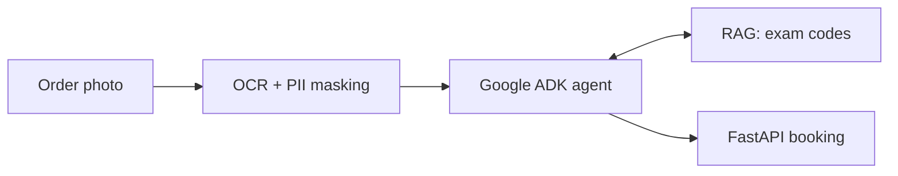
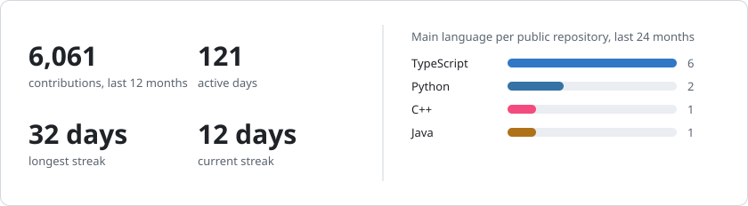
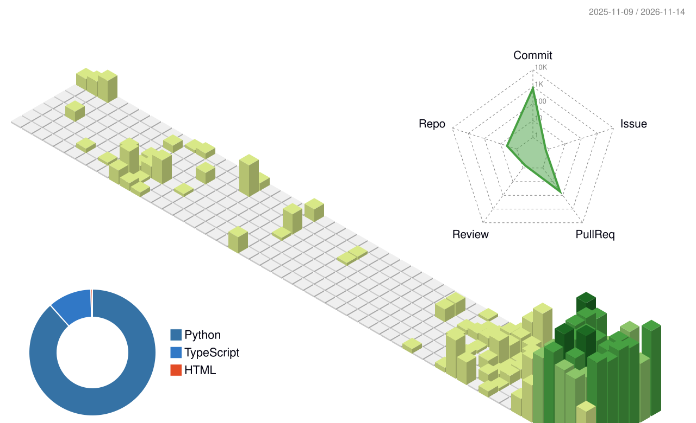

<picture>
  <source media="(prefers-color-scheme: dark)" srcset="assets/header-dark.svg">
  <source media="(prefers-color-scheme: light)" srcset="assets/header-light.svg">
  
</picture>

  
  
  
  
  
  

13 years shipping software. Today: LLMs, RAG and multi-agent systems on React, Node.js, Java and AWS. 
**Open to remote roles** in the Americas and Europe, through an EOR or as a contractor.

[Experience](#experience) · [Work](#selected-work) · [Stack](#stack) · [Activity](#activity)

## Experience

| Company | Years | Impact |
|:--|:--|:--|
| **Qualicorp** | 2025–now | Up to 4× more weekly deliveries with LLM agents and RAG |
| **SkipTheDishes** | 2021–25 | React Native: first load down 38%, abandonment down 11% |
| **Banco do Nordeste** | 2017–21 | Payments modernized; GraphQL BFF over core banking |

AWS Certified Cloud Practitioner · Claude Certified Associate · UNIFOR · Portuguese, English

## Selected work

| Project | What it is | Stack |
|:--|:--|:--|
| **NEXOVARE** | Business management ERP | Java, React, PostgreSQL |
| **App Banco** | Mobile banking | React, Node.js, TypeScript |
| **Bideiras** | Cross-border e-commerce | React, Node.js, PostgreSQL |
| **ClockRight** | Face-recognition time clock | React, GSAP, Cloudflare |
| **Entre Páginas** | Reading club platform | Next.js, TypeScript, GSAP |

<strong>Open source:</strong> <a href="https://github.com/Cabraiz/rag-local-app">rag-local-app</a> turns a medical order photo into a booked exam

 

<!-- recent:start -->
**Recently updated:** [portfolio](https://github.com/Cabraiz/portfolio) · [rag-local-app](https://github.com/Cabraiz/rag-local-app) · [wagner-advocacia](https://github.com/Cabraiz/wagner-advocacia) · [paola-cabral-arquitetura](https://github.com/Cabraiz/paola-cabral-arquitetura)
<!-- recent:end -->

## Stack

<table>
<tr><td><b>AI</b></td><td>LLMs · RAG · multi-agent · MCP · Google ADK · OCR</td></tr>
<tr><td><b>Languages</b></td><td><picture><source media="(prefers-color-scheme: dark)" srcset="assets/stack/languages-dark.svg"></picture></td></tr>
<tr><td><b>Front end</b></td><td><picture><source media="(prefers-color-scheme: dark)" srcset="assets/stack/frontend-dark.svg"></picture></td></tr>
<tr><td><b>Back end</b></td><td><picture><source media="(prefers-color-scheme: dark)" srcset="assets/stack/backend-dark.svg"></picture></td></tr>
<tr><td><b>Tools</b></td><td><picture><source media="(prefers-color-scheme: dark)" srcset="assets/stack/tools-dark.svg"></picture> &nbsp;Playwright · Jira</td></tr>
</table>

## Activity

<picture>
  <source media="(prefers-color-scheme: dark)" srcset="https://raw.githubusercontent.com/Cabraiz/Cabraiz/output/activity-dark.svg">
  
</picture>

<picture>
  <source media="(prefers-color-scheme: dark)" srcset="https://raw.githubusercontent.com/Cabraiz/Cabraiz/output/snake-dark.svg">
  
</picture>

<strong>The last year in 3D</strong>

 

<picture>
  <source media="(prefers-color-scheme: dark)" srcset="https://raw.githubusercontent.com/Cabraiz/Cabraiz/output/calendar-dark.svg">
  
</picture>

  
  &nbsp;<a href="#top">Back to top</a>

